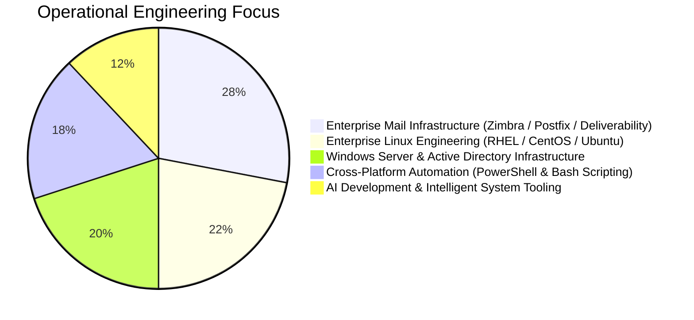

  <!-- Dynamic Typing Header Banner -->
  

  

    <strong>Hybrid Infrastructure Engineer • Enterprise Mail Architect • AI & Automation Developer</strong> 
    Orchestrating mission-critical Windows Server & Linux ecosystems, end-to-end enterprise mail clusters, and autonomous AI-driven automation pipelines.
  

  <!-- Core Ecosystem Badges -->
  

    
    
    
    
    
    
    
  

---

### 🏛️ Engineering Architecture & Core Competencies

<table width="100%" border="0">
  <tr>
    <td width="50%" valign="top">
      <h4>🪟 Windows Server & Enterprise Infrastructure</h4>
      

        Full-lifecycle Windows Server operations across 2016/2019/2022/2025 editions. Administration of Active Directory Domain Services (AD DS), Group Policy (GPO), DNS, DHCP, Hyper-V virtualization, IIS web hosting, Windows Defender Firewall hardening, and WSUS patch management.
      

      

        <code>Windows Server</code> <code>Active Directory</code> <code>Hyper-V</code> <code>IIS</code> <code>GPO</code> <code>WSUS</code>
      

    </td>
    <td width="50%" valign="top">
      <h4>🐧 Enterprise Linux & System Hardening</h4>
      

        Production server administration across CentOS, RHEL, Ubuntu Server, and Debian. Kernel parameter optimization (sysctl), systemd daemon management, logical volume management (LVM), root privilege segregation, SSH bastion security, and unattended security patching.
      

      

        <code>RHEL</code> <code>CentOS</code> <code>Ubuntu</code> <code>Debian</code> <code>Systemd</code> <code>LVM</code> <code>Sysctl</code>
      

    </td>
  </tr>
  <tr>
    <td width="50%" valign="top">
      <h4>📬 End-to-End Enterprise Mail Systems</h4>
      

        Architecting robust Zimbra Collaboration Suite and Postfix MTA mail clusters. Guaranteeing 100% email deliverability with automated SPF, DKIM (2048-bit), DMARC, and PTR reverse DNS records. Automated zero-downtime Let's Encrypt SSL/TLS deployment via certbot and zmcertmgr.
      

      

        <code>Zimbra Suite</code> <code>Postfix</code> <code>Let's Encrypt</code> <code>OpenSSL</code> <code>DKIM/DMARC</code>
      

    </td>
    <td width="50%" valign="top">
      <h4>🤖 AI Automation & Cross-Platform Scripting</h4>
      

        Engineering production automation workflows using Python, PowerShell, and Bash. Integrating Large Language Model (LLM) APIs, autonomous scripting agents, automated log parsing, proactive incident alerting, scheduled tasks, and containerized Docker services behind Nginx.
      

      

        <code>PowerShell</code> <code>Bash</code> <code>Python</code> <code>AI/LLM APIs</code> <code>Docker</code> <code>Nginx</code>
      

    </td>
  </tr>
</table>

---

### 🛠️ Production Tech Stack & Toolchains

  
<em>Multi-platform technologies actively deployed across production environments:</em>

  

 

| Tier | Ecosystem & Toolchain Components |
| :--- | :--- |
| **Operating Systems** | Windows Server (2016-2025), Windows 10/11, CentOS, Red Hat Enterprise Linux (RHEL), Ubuntu Server, Debian |
| **Directory & Virtualization** | Active Directory (AD DS), Group Policy Objects (GPO), Hyper-V, VMware ESXi, Docker Engine, Docker Compose |
| **Mail Infrastructure** | Zimbra Collaboration Suite (ZCS), Postfix MTA, Dovecot, Certbot Automation, zmcertmgr, SpamAssassin |
| **Scripting & AI Automation** | Windows PowerShell 5.1/7+, Linux Bash, Python 3, PyTorch, TensorFlow, LLM APIs, Scheduled Tasks, Systemd Timers |
| **Web & Edge Security** | Nginx Reverse Proxy, Microsoft IIS, Cloudflare WAF & Edge DNS, WireGuard VPN, IPTables / Windows Firewall |

---

### 📊 Operational Telemetry & Workload Distribution

  <!-- Live GitHub Streak Analytics -->
  

 

---

### 📬 Connect & Direct Inquiries

  
  &nbsp;&nbsp;
  

    
  ⚡ Engineered with precision for <strong>0xAndyNew</strong> • Dual-OS Systems, Mail Infrastructure & AI Automation

