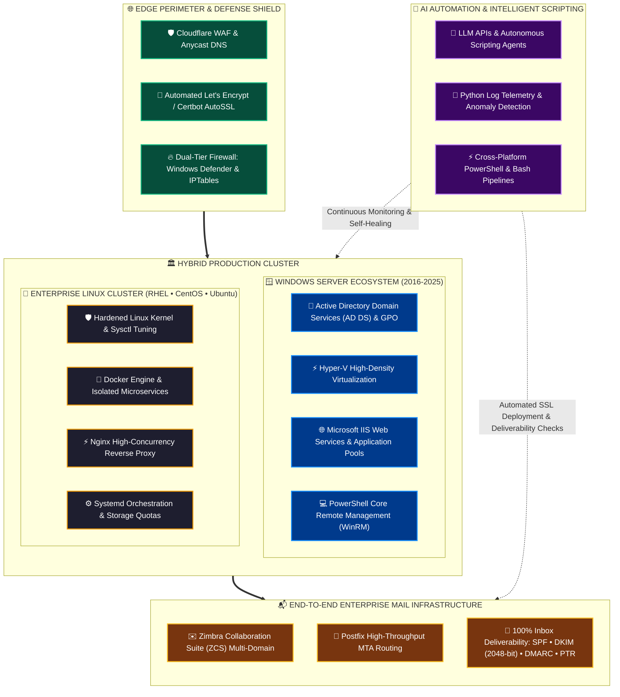
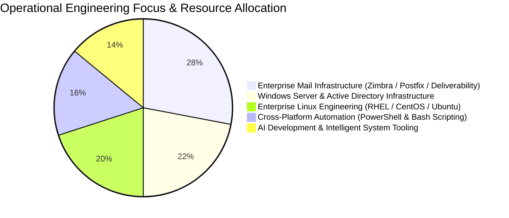

  <!-- Dynamic Typing Header Banner -->
  

   

  <!-- High-Impact Colorful Domain Badges -->
  

    
    
    
    
    
    
  

  

    
    
    
  

---

### 🗺️ Enterprise Infrastructure & Operational Architecture

---

### ⚡ Critical Engineering Highlights & Production Capabilities

<table width="100%" border="0">
  <tr>
    <td width="50%" valign="top">
      
        
      <pre lang="diff">
+ [ENTERPRISE DOMAIN MANAGEMENT]
+ Active Directory (AD DS), Group Policy (GPO), DNS & DHCP
+ Hyper-V Clustering, Virtual Switch Isolation & Disaster Recovery
+ IIS Web Server Optimization, SSL Offloading & App Pools
+ Windows Defender Advanced Firewall & WSUS Patch Governance
! PowerShell 5.1 / 7+ Cross-Server Remote Administration
      </pre>
    </td>
    <td width="50%" valign="top">
      
        
      <pre lang="diff">
+ [HARDENED LINUX PLATFORMS]
+ Production CentOS, RHEL, Ubuntu Server & Debian Engineering
+ Kernel Parameter Tuning (sysctl), Systemd Service Daemons
+ Storage Quotas, Logical Volume Management (LVM) & Hot Backups
+ Zero-Trust SSH Bastion Security & Root Access Segregation
! High-Performance Nginx Reverse Proxy & Docker Microservices
      </pre>
    </td>
  </tr>
  <tr>
    <td width="50%" valign="top">
      
        
      <pre lang="diff">
+ [MISSION-CRITICAL MAIL ARCHITECTURE]
+ Zimbra Collaboration Suite (ZCS) Multi-Tenant Infrastructure
+ Postfix High-Throughput MTA Routing & Dovecot Mailbox Stores
+ 100% Deliverability: SPF, DKIM (2048-bit), DMARC & Reverse DNS (PTR)
+ Automated Zero-Downtime Let's Encrypt SSL via Certbot & zmcertmgr
! Anti-Spam Filtering, Rate-Limiting & Mail Storage Protection
      </pre>
    </td>
    <td width="50%" valign="top">
      
        
      <pre lang="diff">
+ [INTELLIGENT SCRIPTING & AI CODING]
+ Python Production Scripts for Sysadmin Automation & Telemetry
+ Autonomous AI Scripting Agents Powered by Modern LLM APIs
+ Automated Log Parsing, Incident Root-Cause Analysis & Alerts
+ Unattended Maintenance Pipelines via PowerShell & Linux Bash
! Containerized Microservices with Docker & Cloudflare WAF
      </pre>
    </td>
  </tr>
</table>

---

### 🛠️ Production Tech Stack & Glowing Toolchains

  
<em>Multi-platform technologies actively deployed across production environments:</em>

  

 

| Domain & Layer | Prominent Technologies & Production Toolchain |
| :--- | :--- |
|  | **Windows Server (2016 / 2019 / 2022 / 2025), Windows 11 Enterprise, CentOS, RHEL, Ubuntu Server, Debian** |
|  | **Zimbra Collaboration Suite (ZCS), Postfix MTA, Certbot AutoSSL (`zmcertmgr`), SPF / DKIM 2048 / DMARC** |
|  | **Windows PowerShell (5.1/7+), Linux Bash Shell, Python 3, LLM APIs, PyTorch, TensorFlow, Scheduled Jobs** |
|  | **Hyper-V Clustering, Docker Engine, Docker Compose, Active Directory (AD DS), Group Policy Objects (GPO)** |
|  | **Cloudflare WAF, Nginx Reverse Proxy, Microsoft IIS, Windows Defender Firewall, WireGuard VPN, IPTables** |

---

### 📊 Operational Telemetry & Resource Distribution

  <!-- Live GitHub Streak Analytics -->
  

 

---

### 📬 Direct Inquiries & Communications

  
  &nbsp;&nbsp;
  

    
  ⚡ Engineered with precision for <strong>0xAndyNew</strong> • Dual-OS Systems, Mail Infrastructure & AI Automation

