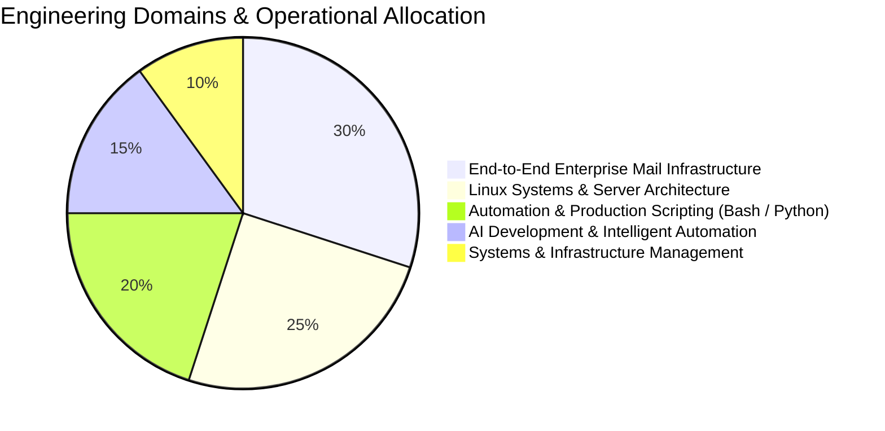

<div align="center">

  <!-- Cinematic Isometric Workspace Hero -->
  

  <br/><br/>

  <!-- Dynamic Typing Header -->
  <a href="https://github.com/0xAndyNew">
    
  </a>

  <p align="center">
    <strong>Systems Administrator • Infrastructure Lead • AI Developer</strong><br/>
    Specializing in end-to-end enterprise mail clusters, Linux server architecture, AI-driven automation scripting, and systems management.
  </p>

  <!-- Status & Quick Badges -->
  <p align="center">
    <a href="mailto:179321164+0xAndyNew@users.noreply.github.com">
      
    </a>
    <a href="https://github.com/0xAndyNew">
      
    </a>
    
    
  </p>

</div>

---

### 💻 System Telemetry & Identity

```bash
andy@0xAndyNew:~$ neofetch --profile
-----------------------------------
OS          : Linux Enterprise (CentOS • RHEL • Ubuntu • Debian)
Role        : Systems Administrator • Infrastructure Lead • AI Developer
Core Stack  : Linux, Bash, Python, AI/ML, Zimbra, Nginx, Docker, OpenSSL
Specialties : Full Mail Infrastructure • AI Automation • Server Hardening
Management  : High-Availability SLA • Incident Response • Security Audits
Uptime      : 99.999% Service Availability Target
Location    : Vietnam 🇻🇳
```

---

### 🛠️ Technical Stack & Tooling

<div align="center">
  <p><em>Curated technologies & toolchains powering production environments:</em></p>
  <a href="https://skillicons.dev">
    
  </a>
</div>

<br/>

<table width="100%">
  <tr>
    <td width="30%"><strong>📬 End-to-End Enterprise Mail</strong></td>
    <td width="70%">
      
      
      
      
      
    </td>
  </tr>
  <tr>
    <td><strong>🐧 Enterprise Linux & Server Systems</strong></td>
    <td>
      
      
      
      
      
      
    </td>
  </tr>
  <tr>
    <td><strong>🤖 AI Engineering & Scripting</strong></td>
    <td>
      
      
      
      
      
    </td>
  </tr>
  <tr>
    <td><strong>🐳 Containers & Web Infrastructure</strong></td>
    <td>
      
      
      
      
      
    </td>
  </tr>
  <tr>
    <td><strong>🛡️ Security, Networking & Management</strong></td>
    <td>
      
      
      
      
      
    </td>
  </tr>
</table>

---

### 📊 Git Telemetry & Workload Distribution

<div align="center">

  <!-- Live GitHub Project & Commit Indicators -->
  <p align="center">
    
    
    
  </p>

  <!-- GitHub Streak & Contribution Analytics (demolab.com server) -->
  <a href="https://github.com/0xAndyNew">
    
  </a>

</div>

<br/>



---

### 📬 Connect With Me

<div align="center">

  <a href="mailto:179321164+0xAndyNew@users.noreply.github.com">
    
  </a>
  <a href="https://github.com/0xAndyNew">
    
  </a>

</div>

<br/>

<div align="center">
  <sub>🛡️ Architected with precision for <strong>0xAndyNew</strong> • Resilient Infrastructure, Mail Systems & AI Engineering</sub>
</div>
