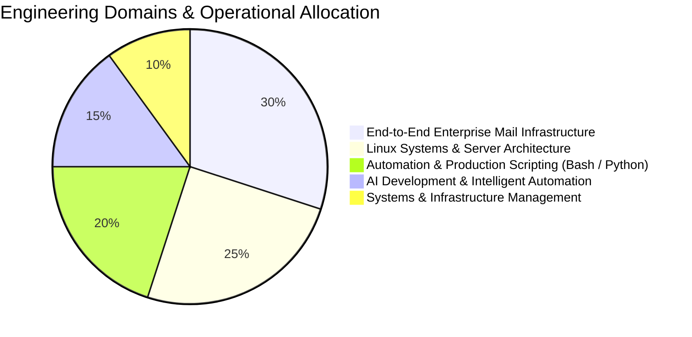

<div align="center">

  <!-- Cinematic Isometric Workspace Hero -->
  

  <br/><br/>

  <!-- Dynamic Typing Header -->
  <a href="https://github.com/0xAndyNew">
    
  </a>

  <p align="center">
    <strong>Systems Administrator • Infrastructure Operations Lead • AI & Automation Engineer</strong><br/>
    Specializing in end-to-end enterprise mail architecture, Linux server hardening, AI-driven automation scripting, and high-availability operations.
  </p>

  <!-- Status & Quick Badges -->
  <p align="center">
    <a href="mailto:179321164+0xAndyNew@users.noreply.github.com">
      
    </a>
    <a href="https://github.com/0xAndyNew">
      
    </a>
    
    
  </p>

</div>

---

### 💻 System Telemetry & Identity

```bash
andy@0xAndyNew:~$ neofetch --profile
-----------------------------------
OS          : Linux Enterprise (CentOS • RHEL • Ubuntu • Debian)
Role        : Systems Administrator • Infrastructure Operations Lead • AI Developer
Core Stack  : Linux, Bash, Python, AI/ML, Zimbra, Nginx, Docker, OpenSSL
Specialties : Full Mail Infrastructure • AI Automation • Server Hardening
Management  : High-Availability SLA • Incident Response • Security Audits
Uptime      : 99.999% Service Availability Target
Location    : Vietnam 🇻🇳
```

---

### 🛠️ Technical Competency & Execution Matrix

<div align="center">
  <p><em>Curated technologies & toolchains powering production environments:</em></p>
  <a href="https://skillicons.dev">
    
  </a>
</div>

<br/>

| Domain & Core Competency | Execution Index | Production Scope & Key Deliverables | Core Toolchain |
| :--- | :---: | :--- | :--- |
| **📬 End-to-End Enterprise Mail** | `████████████████████` **Expert (100%)** | • Multi-domain Zimbra Collaboration Suite & Postfix MTA cluster architecture<br/>• Strict deliverability: Automated SPF, DKIM (2048-bit), DMARC & PTR records<br/>• Zero-downtime Let's Encrypt automated certificate renewals & deployments<br/>• In-depth antispam/antivirus filtering, storage quotas & mailbox migration | `Zimbra` `Postfix` `Let's Encrypt` `OpenSSL` `DMARC/DKIM` |
| **🐧 Linux Server & OS Engineering** | `████████████████████` **Expert (100%)** | • Comprehensive administration across CentOS, RHEL, Ubuntu Server & Debian<br/>• OS performance tuning, systemd daemon management & storage optimization<br/>• OS-level hardening, root segregation, SSH Bastion & kernel sysctl tuning | `CentOS` `RHEL` `Ubuntu` `Debian` `Systemd` `Sysctl` |
| **⚡ Production Scripting & DevOps** | `██████████████████░░` **Senior (95%)** | • Advanced Bash Shell automation pipelines & Python sysadmin scripts<br/>• Headless Linux Cron jobs, automated hot backups & unattended maintenance<br/>• Docker containerization, Docker Compose stacks & Nginx reverse proxies<br/>• Automated CI/CD deployment pipelines via GitHub Actions & Ansible playbooks | `Bash` `Python` `Docker` `Nginx` `GitHub Actions` `Ansible` |
| **🤖 AI Engineering & Automation** | `████████████████░░░░` **Advanced (85%)** | • Integration of LLM APIs & autonomous AI scripting agents into operations<br/>• Intelligent system log analysis, automated root-cause detection & alerting<br/>• Machine learning pipelines & automation tools using PyTorch & TensorFlow | `Python` `PyTorch` `TensorFlow` `LLM APIs` `AI Agents` |
| **🛡️ Security & Systems Management** | `████████████████░░░░` **Lead (85%)** | • Network perimeter defense: Multi-tier IPTables/UFW firewalls & WireGuard VPN<br/>• Edge caching, DNS management & Web Application Firewall (WAF) via Cloudflare<br/>• Uptime governance, SLA management (99.999%), DR planning & incident audits | `WireGuard` `Cloudflare` `IPTables` `SLA/DR` `Security Audits` |

---

### 📊 Git Telemetry & Workload Distribution

<div align="center">

  <!-- Live GitHub Project & Commit Indicators -->
  <p align="center">
    
    
    
  </p>

  <!-- GitHub Streak & Contribution Analytics (demolab.com server) -->
  <a href="https://github.com/0xAndyNew">
    
  </a>

</div>

<br/>



---

### 📬 Connect With Me

<div align="center">

  <a href="mailto:179321164+0xAndyNew@users.noreply.github.com">
    
  </a>
  <a href="https://github.com/0xAndyNew">
    
  </a>

</div>

<br/>

<div align="center">
  <sub>🛡️ Architected with precision for <strong>0xAndyNew</strong> • Resilient Infrastructure, Mail Systems & AI Engineering</sub>
</div>
